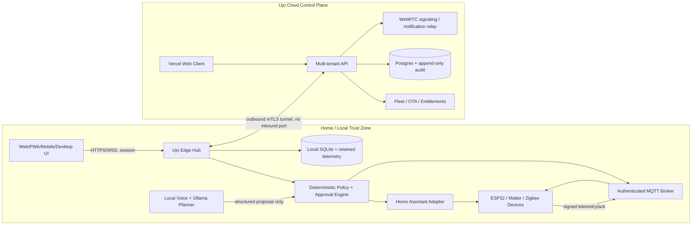

# Ujo OS Production Readiness Report

**Assessment date:** 2026-07-20  
**Target:** Global, offline-first, multi-user smart-home ecosystem spanning edge hub, hardware nodes, web/PWA, mobile/desktop shells, cloud fleet management, and conversational AI.

## Executive finding

Ujo is no longer merely a UI demo. The supplied code already contains a strong edge foundation: an Express/TypeScript hub, Prisma persistence, authenticated sessions, signed MQTT envelopes, replay protection, approval-gated hardware commands, Home Assistant WebSocket integration, local STT/TTS adapters, Ollama planning, energy/water/food/maintenance intelligence, PWA/Capacitor shells, Docker deployment, systemd startup, and ESP32 firmware profiles.

This pass hardens the most dangerous gap: **a UI/database state change can no longer be presented as a successful physical action.** Devices now require an explicit controller binding. Unbound devices fail closed; MQTT actions wait for owner approval and a signed node acknowledgement; Home Assistant actions remain pending until a reported state is synchronized; and locks can only be operated through the dedicated authenticated access path.

The project is a credible **production foundation**, not yet a sellable, certified appliance. Shipping requires physical hardware validation, electrical and radio certification, a multi-tenant cloud control plane, penetration testing, secure manufacturing/provisioning, signed OTA with rollback, mobile store release work, and field trials.

## What was completed in this pass

1. Added an explicit device-control abstraction with `UNBOUND`, `SIMULATION`, `HOME_ASSISTANT`, and `MQTT` providers.
2. Added controller target, desired state, command status/error, and reported-state timestamps to the device model and a rerunnable migration.
3. Changed device controls from optimistic database writes to fail-closed dispatch.
4. Isolated lock access behind validated owner, duress, or scheduled-staff credentials.
5. Added a dedicated Home Assistant lock service method that is unreachable from generic assistant commands.
6. Added signed MQTT acknowledgement reconciliation back into device state.
7. Added owner-authenticated device binding and control APIs.
8. Added role protection for mutating APIs.
9. Disabled simulation, random telemetry, fake subscriptions, fake phone location, and manual power-source mutation by default.
10. Replaced invented energy values with the latest persisted signed telemetry or an explicit “No telemetry” state.
11. Added capabilities reporting so clients can distinguish configured, unavailable, pending, simulated, and unbound behavior.
12. Updated the UI to disable unbound/pending controls and display rejected or approval-pending actions.
13. Added a Vercel Function gateway. Preview mode fixes login and provides a read-only demonstration; proxy mode forwards authenticated requests to a fixed HTTPS hub.
14. Added polling fallback when Socket.IO is unavailable through the gateway while retaining real-time Socket.IO for direct hub clients.
15. Added a one-command Debian/Ubuntu hub installer that creates secrets/certificates and launches MQTT, Ujo, Ollama, faster-whisper and Piper.
16. Added profile-specific Ollama installation for assistant, embeddings and vision plus a factory preload workflow.
17. Added signed event-triggered ESP32-CAM ingestion and camera firmware.
18. Added ESPHome voice-satellite and legacy IR bridge reference configurations.
19. Added native mobile context/BLE onboarding scaffolds and a Tauri desktop shell.
20. Supplied a strict MARK-XXXIX → Ujo bridge patch that removes arbitrary remote execution from the smart-home trust boundary.
21. Added Vercel, hub, hardware/BOM, end-to-end deployment, cloud, model, benchmark, and integration specifications.

## Current architecture

## Non-negotiable safety model

- An LLM may **propose** a typed tool call; it never directly switches a relay.
- Deterministic code validates identity, role, device binding, state schema, safety class, policy, freshness, and approval.
- Locks, gates, alarms, payment/vendor orders, generator starts, mains contactors, and other high-consequence actions require a dedicated flow and step-up authentication.
- A command is not “complete” until the physical controller reports state or returns a signed acknowledgement.
- Timeouts, stale telemetry, missing controller bindings, and conflicting sensors result in `UNKNOWN`, `DEGRADED`, or `FAILED`—never invented success.
- Every automatic action needs a reason code, inputs used, policy version, actor, timestamps, and outcome.
- Physical manual override must remain available for life-safety and essential home functions.

## Deployment boundaries

### Vercel

Deploy the repository using `vercel.json`. `api/gateway.ts` provides a working environment-backed preview login or a proxy to a fixed HTTPS hub. Set `VITE_UJO_GATEWAY=true` before building. A Vercel deployment still cannot become the local MQTT/AI/device hub; the home appliance must establish an outbound secure tunnel when remote access is required.

### Edge hub

The hub belongs on a Raspberry Pi 5 for a prototype or, preferably, an x86-64/ARM64 appliance with NVMe, TPM 2.0/secure element, UPS, hardware watchdog, Ethernet, Wi-Fi, BLE, Zigbee/Thread radio, and a read-only recovery partition. Run the hub services with Docker Compose or a signed immutable OS image, not Vercel.

### Cloud control plane

Use a tenant-isolated Postgres database with mandatory `organization_id` and `home_id` boundaries, row-level security, a durable command queue, per-hub certificates, an append-only audit stream, signed entitlements, and staged OTA rings. The cloud must never be required for local lights, locks, safety automations, or voice commands.

## Release readiness score

| Area | Current state | Release gate |
|---|---|---|
| Edge hub services | Strong foundation | Soak test, watchdog, immutable image, recovery |
| Generic device control | Fail-closed foundation | Test with actual HA/MQTT devices |
| Access control | Safer software boundary | Certified lock integration, anti-passback, physical tests |
| Hardware protocol | Signed/replay-protected | Secure-element keys, manufacturing provisioning, fuzzing |
| Local AI | Ollama/Whisper/Piper stack and bootstrap | Hardware benchmarks, red-team, multilingual/acoustic tests |
| Mobile/PWA | Functional shell plus native scaffolds | Compile, secure keystore, BLE/background permission and store tests |
| Desktop companion | Safe bridge patch | Reimplement/license review, sandbox tool permissions |
| Multi-tenancy | Not implemented in edge DB | Build cloud control plane and tenant isolation tests |
| OTA | Requirements only | Signed manifests, A/B rollback, staged rollout |
| Compliance | Not started | Country-specific electrical/radio/privacy/security certification |
| Operations | Partial | Monitoring, incident response, support, RMA, fleet runbooks |

## Added deployment references

- `docs/VERCEL_TEST_DEPLOYMENT.md` — exact login fix, preview and real-hub deployment.
- `docs/HUB_INSTALLATION_AND_TESTING.md` — one-command install, embedded models and commissioning.
- `docs/HARDWARE_DESIGN_AND_BOM.md` — hub/node architecture, wiring boundaries and BOM categories.
- `docs/END_TO_END_TEST_PLAN.md` — staged validation from cloud preview to commercial release.

## The next executable milestones

### Milestone 1 — Hardware-in-the-loop alpha

- Provision one energy node, one water node, one presence node, one food-environment node, and one non-safety relay.
- Bind each Ujo device through `/api/devices/:id/bind`.
- Verify signed telemetry, replay rejection, command approval, acknowledgement, timeout, reboot, and offline recovery.
- Do not connect prototype relays directly to mains, locks, pumps, generators, gas valves, or fire-safety equipment.

### Milestone 2 — Home pilot

- Add Home Assistant/Matter commissioning, room/device inventory, mobile secure enrollment, household roles, local notification routing, backups, and restore drills.
- Run 30-day offline, power-loss, network-loss, and disk-pressure tests.
- Measure false alerts, command latency, state mismatch, notification fatigue, and user overrides.

### Milestone 3 — Commercial fleet

- Add the cloud control plane, per-home certificates, subscription entitlements, technician workflows, signed OTA rings, anonymized opt-in analytics, RMA, and customer support.
- Complete threat modeling, independent penetration testing, privacy impact assessment, SBOM/signing, and regulatory certification.

## Explicit limitations

- No software-only review can certify mains switching, locks, pumps, generators, gas systems, or life-safety controls.
- The ESP32, camera, voice and IR configurations are reference implementations, not certified final PCBs, acoustic products or enclosures.
- Model binaries are installed or factory-preloaded by scripts rather than embedded in the source ZIP because they are multi-gigabyte separately licensed artifacts.
- A broad VOC sensor cannot prove ethylene concentration or food safety. Ujo must present it as a trend/anomaly input and combine it with temperature, humidity, visual observations, shelf-life references, and user confirmation.
- The local database is appropriate for a single hub/home. It is not the global SaaS tenant database.
- MARK-XXXIX should remain outside the safety-critical control boundary and must not be commercially shipped until its licensing and secret-management issues are resolved.
